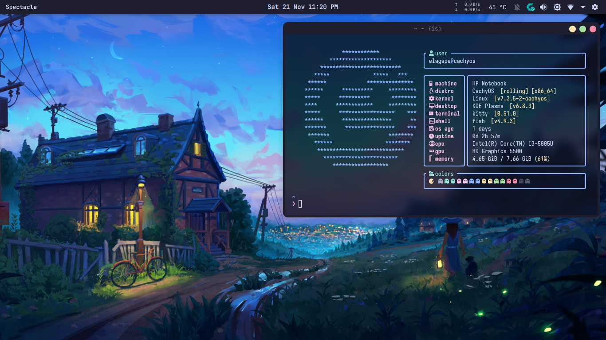

# Fastfetch Rice



## Installation

### 1. Install fastfetch and git

| Distro | Command |
|---|---|
| Arch / CachyOS / Manjaro / EndeavourOS | `sudo pacman -S fastfetch git` |
| Debian 13+ / Ubuntu 24.04+ | `sudo apt install fastfetch git` |
| Older Debian / Ubuntu | Download the `.deb` from the [fastfetch releases](https://github.com/fastfetch-cli/fastfetch/releases), then `sudo apt install ./fastfetch-*.deb git` |
| Fedora | `sudo dnf install fastfetch git` |
| openSUSE | `sudo zypper install fastfetch git` |
| Alpine | `sudo apk add fastfetch git` |
| Void | `sudo xbps-install -S fastfetch git` |
| Gentoo | `sudo emerge app-misc/fastfetch dev-vcs/git` |
| NixOS | `nix-shell -p fastfetch git` |
| macOS (Homebrew) | `brew install fastfetch git` |

### 2. Clone the repo
```bash
git clone https://github.com/elagape/dotfiles.git ~/dotfiles
```

### 3. Install the config
```bash
mkdir -p ~/.config/fastfetch
cp -r ~/dotfiles/fastfetch/* ~/.config/fastfetch/
```

### 4. Run it
```bash
fastfetch
```

## Files
- `fastfetch/config.jsonc`: main config
- `fastfetch/cachy.txt`: custom ASCII logo
- `screenshots/`: preview image

## Notes
- The logo path in the config is `~/.config/fastfetch/cachy.txt`, so keep the files together.
- Icons need the [JetBrains Mono Nerd Font](https://www.nerdfonts.com/font-downloads) set in your terminal.


## Credits

- Fastfetch config adapted from [capricorn034/dots](https://github.com/capricorn034/dots/blob/main/fastfetch/3.jsonc)
